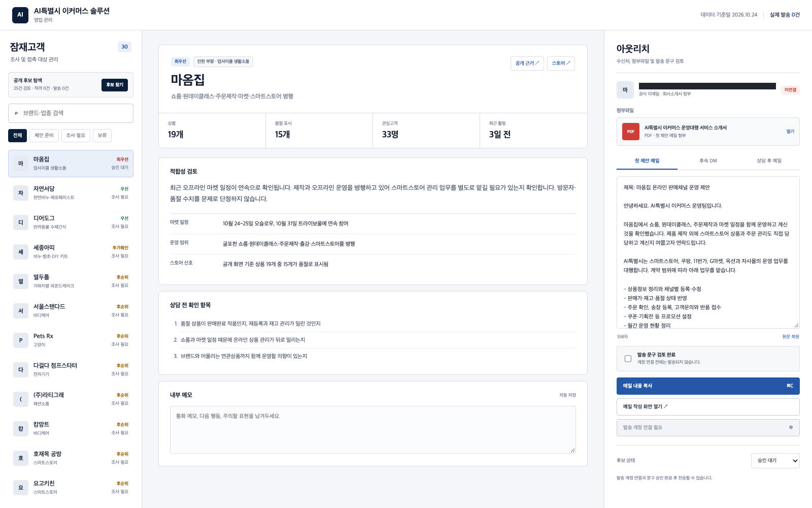
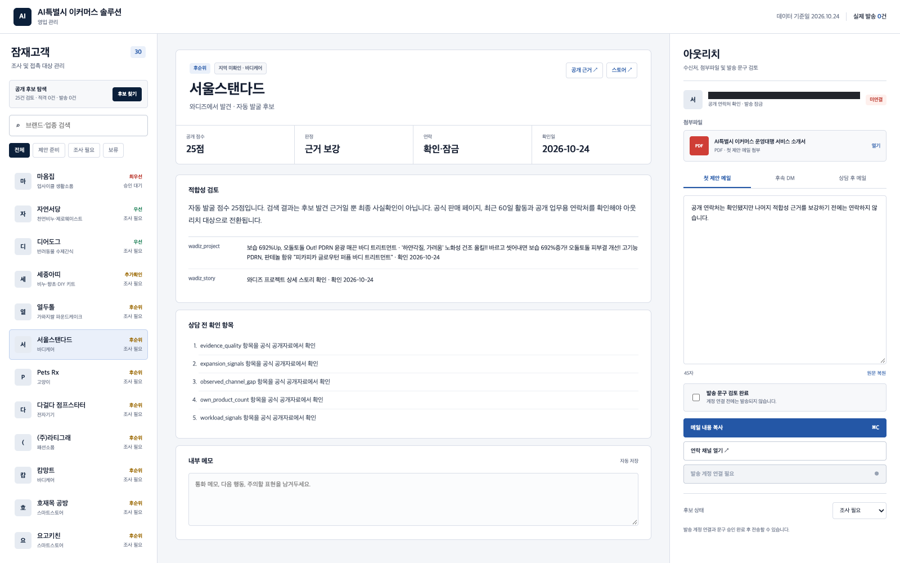
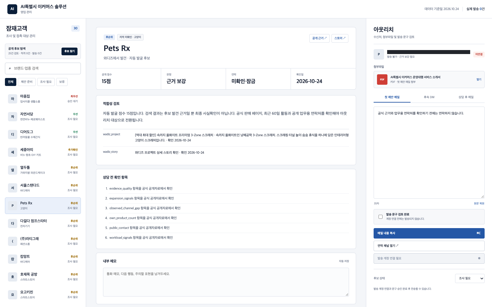

# AI특별시 이커머스 GTM Agentic Loop

자체 상품은 있지만 온라인 판매 운영 인력이 부족한 소규모 브랜드에게 **멀티채널 운영대행**을 파는 GTM 루프입니다. 평가 기간 2026-10-25 ~ 10-31 18:00 KST.

## 지금 성과 (매일 갱신)

| 지표 | 7일 목표 | 현재 | 근거 |
|---|---|---|---|
| 실제 컨택 | 30 | **3** | [`contacts/log.csv`](contacts/log.csv) |
| 연결자 소개 | 3 | **1** | log C001 → C002 |
| 진단 제안서 | 3 | **1** (18쪽) |
| 투자 미팅 (도달) | — | **1** (12/9 확정) | log C003 | [사례 C002](docs/cases/C002_referral_to_diagnosis.md) |
| 상담 (20분 이상) | 3 | 0 (1건 약속) | 같은 파일 C002 |
| 유료 결제 | 1 | 0 | — |
| 사례 콘텐츠 게시 | 7 | 0 (초안 4) | [`content/`](content/) |
| 루프 회전 기록 | 7 | 4 | [`runs/`](runs/) |

전체 스코어보드와 목표 변경 이력: [`GOALS.md`](GOALS.md)

> **하이라이트 — 대면 1건 → 소개 → 같은 날 18쪽 진단 제안서.** 투자사 초기투자팀 팀장과의 미팅에서 오프라인 리테일 고객사를 소개받았고, 에이전트가 공개 자료만으로 진단·성장 전략·기대효과·대표 역질문 30개를 하루 안에 만들었다. 대표 미팅 예정. 같은 날 콘텐츠 기업을 통해 **12/9 VC 투자 미팅**도 확정(C003). → [사례 C002](docs/cases/C002_referral_to_diagnosis.md)

## 제품과 고객 (전략 정합성)

- **제품**: 스마트스토어·쿠팡·토스쇼핑·11번가·G마켓·옥션 상품 등록, 상품명·키워드, 재고·가격 점검, 광고 운영을 AI 에이전트로 대행. 브랜드는 제품 제작과 발주만 맡는다.
- **우리가 직접 증명한 것**: 같은 에이전트로 6개 몰에서 실제 스토어를 운영 중이다. 사례 글은 이 운영 데이터로만 쓴다(예: 품절 신호 오판 157개 발견·수정).
- **고객(ICP)**: 자체 상품 3~30개, 판매 실적이 있지만 채널을 1~2곳만 운영하는 소규모 브랜드·오프라인 매장.
- **상품 사다리**: 진단(착수 전 분석 보고서) → 4주 스프린트 → 월 운영.

## 루프 구조

```
 ① 발굴 ──▶ ② 검증 ──▶ ③ 합법 게이트 ──▶ ④ 접점 ──▶ ⑤ 진단 제안 ──▶ ⑥ 기록·회고
   ▲                                                                │
   └────────────── 다음 회차 규칙 변경 (runs/ "바꾼 것과 이유") ◀──────┘
```

1. **발굴**: 와디즈·텀블벅 공개 페이지, 요청 플랫폼(크몽·숨고·위시켓), 연결자(투자사·창업지원 기관) 소개.
2. **검증**: 자체 상품 수, 최근 활동, 채널 공백을 공개 근거로 확인. 근거가 없으면 `조사 필요`로 두고 연락하지 않는다 (`discovery/`).
3. **합법 게이트**: 정보통신망법 제50조상 사업자에게도 먼저 보내는 영업 메시지는 사전 동의가 필요하다. 그래서 아래 근거 중 하나가 있어야만 접점을 만든다 — ① 상대 요청 ② 대면 동의 ③ 자료 요청 ④ 공고 응모 ⑤ 대면·소개.
4. **접점**: 요청 회신, 인바운드 응답, 대면·소개, 우편(전자적 전송이 아니어서 제50조 대상 아님, 수신거부 방법 기재).
5. **진단 제안**: 상대 스토어·시장 공개 자료로 착수 전 분석 보고서를 만든다. 수치는 출처 번호, 추정은 '추정'으로 표기.
6. **기록·회고**: 컨택마다 `contacts/log.csv`에 합법 근거와 결과를 남기고, 하루 끝에 `runs/`에 "어제 대비 바꾼 것과 이유"를 쓴다.

## 회차별 개선 (중간 결과 → 루프 변경)

| 회차 | 중간 결과 | 바꾼 것 |
|---|---|---|
| 0 (10/24) | 발굴·점수·발송 차단 게이트 구현, 발송 0 | — |
| 1 (10/25) | 법규 원문 검토: 콜드 이메일·DM은 위법 | 콜드 아웃바운드 폐기, 목표를 '합법 컨택 수'로 변경, 가격 사다리 재설계 |
| 2 (10/26) | 크몽 상품 심사 대기, 플랫폼 요청은 평가 기간 내 물량 부족 | 요청 회신 채널 추가 → 직접 발굴+우편 편지로 전환, 후보 74 → 검증 22 |
| 3 (10/27) | **VC 팀장 대면 1건이 고객사 소개·진단 요청으로 이어짐** | 합법 근거에 '대면·소개' 추가, 연결자 경로를 1순위로 |
| 4 (10/28) | 크몽 진단 상품 승인 → 인바운드 채널이 열림. 커머스 의뢰는 하루 안에 마감 | 소개용 한 장에 크몽 상품 링크, 의뢰는 알림 받아 당일 제안, 자체 사이트에 '상품 1개 손익 미리보기 무료' 신청 페이지 [/commerce/](https://ai-specialtime.com/commerce/) 공개(10/29 배포·테스트 신청 접수 확인) |

자세한 내용: [`runs/`](runs/)

## 남은 기간 계획 (10/28 ~ 10/31) — 연결자 루프 확대

회차 3의 결론: **고객에게 직접 닿는 것보다 '고객을 많이 아는 사람' 1명에게 닿는 것이 컨택 효율이 높다.** 남은 4일은 이 경로를 늘리고, 진단 제안서를 계약으로 바꾸는 데 쓴다.

| 우선 | 할 일 | 목표 지표 | 합법 근거 |
|---|---|---|---|
| 1 | C002 대표 미팅 → 진단 착수 합의 | 상담 1, 결제 1 | ① 상대 요청 |
| 2 | C001에게 2차 소개 요청 + [소개용 한 장](content/referral_onepager.md) 전달 | 연결자 소개 +2, 컨택 +2~4 | 기존 관계(대면 후속) |
| 3 | 크몽: **진단 상품 승인·판매 시작(10/28, [상품 페이지](https://kmong.com/gig/847365))** · 엔터프라이즈 전문가 등록 완료 → 의뢰 기업 프로젝트에 하루 2회 확인·당일 제안 (최근 마케팅 의뢰 50건 중 적합 12%) | 요청 회신 컨택 | ① 상대 요청 |
| 4 | 사례 글 게시 (운영 데이터 기반 4편 준비) | 콘텐츠 7 | — |
| 5 | 우편 편지(검증 22곳, 수신거부 방법 기재) | 회신 → 컨택 | 전자적 전송 아님 |

매일 끝에 `runs/`에 "바꾼 것과 이유"를 쓰고, 지표가 안 움직이는 경로는 다음 날 줄인다.

## 공개 원칙

- 상대 이름·연락처·주소는 올리지 않는다. `contacts/log.csv`는 익명 ID만, 원본은 git 제외 폴더(`contacts/private/`).
- 증빙 이미지는 개인정보를 모자이크한 사본만 (`docs/evidence/`).

---

## v1 (10/24 제출본) — 발굴·검증 도구

### 실행계획서

[AI특별시 이커머스 GTM 실행계획 PDF](docs/AI_Special_City_GTM_Execution_Plan.pdf)

오늘 구현한 고객 발굴·검증 결과와 7일 실행계획, 목표 지표, 안전 기준을 한 문서로 정리했습니다. 공개 저장소용이므로 실제 후보 연락처와 자체 운영 로직은 포함하지 않았습니다.

### 실행 화면

### 1. 잠재고객 조사와 제안 검토를 한 화면에서 관리

후보 목록, 공개 근거, 상담 전 확인 항목과 제안 문구를 함께 검토합니다. 실제 발송 수와 연결 상태를 화면에서 분리해 표시합니다.



### 2. 와디즈 직접 발굴 후보의 근거와 미확인 항목 검토

와디즈 프로젝트에서 확인한 사실과 추가로 확인해야 할 항목을 구분합니다. 공개 연락처가 발견되어도 나머지 적합성 근거가 부족하면 발송하지 않습니다.



### 3. 근거가 부족한 후보의 아웃리치 자동 차단

연락처, 자체상품 수, 판매채널 공백 등 핵심 근거가 확인되지 않은 후보는 `조사 필요`로 남고 발송 기능이 잠깁니다.



스크린샷의 공개 연락처는 저장소 공개용 이미지에서 마스킹했습니다.

### 해결하려는 문제

자체 제품 3~15개를 만드는 1인·소규모 브랜드는 제품 제작과 발주는 직접 할 수 있지만, 스마트스토어·쿠팡·11번가·G마켓·옥션·자사몰의 상품 등록, 재고, 주문, 고객문의와 프로모션을 동시에 운영하기 어렵습니다.

AI특별시는 브랜드가 제품 제작과 공급처 발주를 맡고, AI특별시가 여러 판매채널의 운영을 대행하는 서비스입니다. 필요하면 브랜드에 맞는 연관 도매상품을 사전 승인 후 추가하여 카테고리 전문몰로 확장합니다.

### GTM 루프

1. 스마트스토어, Instagram, 와디즈, 텀블벅, 박람회·지원사업 공개 페이지에서 후보를 찾습니다.
2. 자체상품 수, 최근 60일 활동, 판매채널 공백, 운영 복잡도, 카테고리 확장성, 공개 업무용 연락처와 근거 품질을 평가합니다.
3. 운영 중단, 리셀러 전용, 오래된 활동 등 명확한 부적격 신호는 제외합니다.
4. 사실이 부족하면 점수를 만들지 않고 `조사 필요`로 남깁니다.
5. 검증된 후보만 맞춤 제안 대상으로 올리고, 모든 외부 메시지는 사람의 최종 승인 뒤 발송합니다.
6. 회신·상담·거절 사유를 다음 탐색과 메시지 개선에 반영합니다.

### 이번 구현의 특징

- 와디즈는 검색엔진 결과가 아니라 공식 사이트를 Playwright로 조사해 확인한 공개 목록·상세 데이터 경로를 사용합니다.
- 공개 문의 문맥에 있는 업무용 이메일만 인식하고 플랫폼 공용 주소는 제외합니다.
- 후보 100점 점수표와 하드 게이트를 분리하여, 점수가 높아도 근거가 부족하면 자동 연락하지 않습니다.
- 서로 다른 와디즈 프로젝트나 판매자를 같은 도메인이라는 이유로 합치지 않습니다.
- 실제 발송은 구현 단계에서 잠가 두었으며 현재 발송 건수는 0건입니다.

### 현재 결과

- 공개 후보 25개 수집
- 와디즈 직접 후보 5개 확인
- 공개 업무용 연락처가 있는 후보 1개 확인
- 적합성 근거가 충분한 자동 발송 대상 0개
- Python 테스트 26개, JavaScript 테스트 8개 통과

현재 수치는 “발송량”보다 허위 후보·성급한 연락을 막는 안전장치 검증에 초점을 둔 초기 실행 결과입니다.

### 7일 목표

- 매일 1회 이상 루프 실행, 실행 기록 7회 확보
- 중복 제거된 잠재고객 100개 수집
- 공식 판매 페이지·최근 활동·업무용 연락처까지 확인된 후보 20개 확보
- 사람 검토를 통과한 개인화 제안 10건 발송
- 답변 또는 상담 전환 2건 이상 확보
- 회신·무응답·거절 사유를 반영해 점수 규칙 또는 메시지를 최소 2회 개선

### 실행 및 테스트

```bash
python3 -m unittest discover -s discovery/tests
node --test tests/*.test.mjs
```

외부 후보 탐색은 공개 정보만 사용합니다. CAPTCHA·로그인 우회는 하지 않으며 메시지 전송은 별도 승인 단계입니다.

### 주요 파일

- `discovery/sources.py`: 공개 후보 수집과 와디즈 직접 어댑터
- `discovery/scoring.py`: 점수와 아웃리치 게이트
- `discovery/dedupe.py`: 판매자·프로젝트 중복 제거
- `discovery/discover.py`: 소스별 탐색 루프
- `app-model.mjs`: 검토 화면용 후보 모델
- `docs/implementation-plan.md`: 구현 계획과 검증 기준

